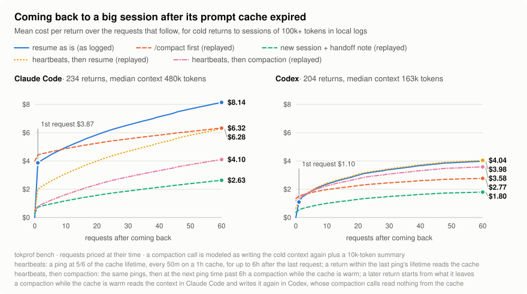

# tokprof

A token, cost and prompt-cache profiler for AI coding-agent session logs (Claude Code, Codex).
It reads the logs the agents already write. It needs no proxy and no account, and nothing leaves the machine.

<picture>
  <source media="(prefers-color-scheme: dark)" srcset="docs/bench-dark.svg">
  
</picture>

## Why

A long session is cheap while its prompt cache is warm, because each request reads the context from the cache at a tenth of the input price or less. The cache lives 5 minutes or an hour in Claude Code and about 30 minutes in Codex. After a longer break, the first request writes the whole context again. For a 500k-token Claude Code session, that one request costs about $4, and every request after it still reads the old context.

`tokprof bench` measured this on one developer's logs: 234 returns to Claude Code sessions and 204 returns to Codex sessions, each with a context of 100k+ tokens. It follows each return for up to 60 requests, until the next break or compaction, and replays the same requests four other ways:
- **`/compact` first.** The compaction call writes the cold context again and outputs a summary. In Codex the call goes without the conversation's tools, so it reads nothing from the cache and writes the whole context, warm or cold. The requests then run on top of what a compaction leaves: a median of 56k tokens for Claude Code and 21k for Codex.
- **A new session with a handoff note.** The old session writes the note before the break, while its cache is still warm. A new session then runs the requests on top of the same base.
- **Heartbeats, then resume.** While the session is idle, a ping at 5/6 of the cache lifetime reads the context, which keeps the cache warm. That is every 50 minutes on Claude Code's 1-hour cache, for up to 6 hours after the last request. A return within the lifetime of the last ping reads its context from the cache. A later one is cold anyway, after the pings.
- **Heartbeats, then compaction.** The same pings, and at the next ping time past the 6 hours a compaction instead, while the cache is still warm. It reads the context in Claude Code and writes it again in Codex. A return before it is warm; a later one goes on from what the compaction leaves.

| Mean per return over 60 requests, API-equivalent | resume as is | /compact first | new session + handoff note | heartbeats, then resume | heartbeats, then compaction |
|---|---:|---:|---:|---:|---:|
| Claude Code: 234 returns, median context 480k | $8.14 | $6.32 | $2.63 | $6.28 | $4.10 |
| Codex: 204 returns, median context 163k | $3.98 | $2.77 | $1.80 | $4.04 | $3.58 |

What this means:
- A handoff note written before the break would have saved 68% of what the Claude Code returns cost ($1,289 of $1,905), and 55% for Codex ($445 of $812).
- The note was cheaper in every one of the 438 returns. The median return would have saved $4.76 (71%) in Claude Code and $2.13 (59%) in Codex.
- Once the cache is cold, `/compact` first pays off only from the 9th request in Claude Code and the 4th in Codex.
- Heartbeats would have kept 146 of the 234 Claude Code returns warm, for $94 of pings, and saved 23% ($435). They save only the cold write of the first request: every request after it still reads the whole context, so the note was cheaper in 212 of the 234 returns. In Codex they would have cost $12 more than resuming. Its cache lives 30 minutes, so the pings go out every 25 minutes, and a cache write there costs 10 to 25 reads, against 40 on Opus 5.5's 1-hour cache.
- A program that pings cannot tell which breaks end in a cold return. It also pings after each conversation's last request, and through breaks the user came back from while the cache was still warm. In Claude Code those pings cost another $108, so heartbeats save 17% ($327).
- Heartbeats, then compaction would have saved 50% in Claude Code ($946): 145 returns came back warm and 89 after a compaction. With what it sends through the other breaks, 42% ($791). In Codex it saves 10% on the returns ($81), because its compaction writes the whole context again, and the pings and compactions through the other breaks make it cost $257 more than resuming.

tokprof shows this for each session. The X-ray says when the cache goes cold, what the next request will cost and which way of carrying on is cheapest. Its forecast of the first request after a break was within 10% of the logged cost for 88% of the Claude Code returns and 96% of the Codex returns.

To run the bench on your own logs: `tokprof bench --svg docs/bench.svg`. The run behind this chart is in [docs/bench.txt](docs/bench.txt).

### A new session that refers to the old one

The replay assumes the new session starts from a handoff note. A live experiment showed that a reference to the old session is enough. It used the most extreme cold sessions in the logs, four of Claude Code and two of Codex: the longest, the fullest context, the biggest log, the most requests. A new session in the same agent got the old session's id, its id and log path, or a note built from the log, and a read-only task: find out what was done and what is left. Each new session:
- found the old log and pulled the prompts and messages out of it with a short script;
- named the task, the work done and what was left;
- checked the project for what had changed since.

<picture>
  <source media="(prefers-color-scheme: dark)" srcset="docs/reference-bench-dark.svg">
  
</picture>

- **Claude Code.** A new session picked up the work for $0.26–0.50, in under a minute. Resuming these sessions would have cost $4.27–8.40 for the first request alone, and every request after it would read the old context again.
- **Codex.** Its sessions stay under the 258k window however long they run, so they are cheaper to resume: $0.60 and $1.10 here. With the log path, a new session on the same model still cost less: $0.22 and $0.38.
- **The reference.** The note built from the log was the cheapest in every session, by a few cents. But it holds only the start and the end of a session, and once it led to "nothing is left". With the log path, the agent reads what it needs itself.
- **The end of a log is not the whole session.** For the session with the most requests, a week of work, the answers built from the end of the log described only its last day.

`tokprof handoff` prints the line with the id and the log path, and the X-ray suggests it.

The write-up, with the prompts, the results of every variant and the limits, is in [docs/reference-bench.md](docs/reference-bench.md). The bench is in [bench/reference](bench/reference).

### One agent picking up the other's session

A separate experiment swapped the agents on the same extreme sessions, plus one more Codex session for a clean id-only run. Codex picked up Claude Code sessions, and Claude Code picked up Codex ones, from the same references.
- **Finding the log.** Each agent found the other's log by the id and read it with a short script. 18 of 19 answers got the task, the work, the last step and what was left right.
- **Codex picking up Claude Code sessions.** It cost $0.52–1.78, against $4.27–8.40 for resuming them in Claude Code. That holds although its default model, gpt-6-astra, costs about 2.5× as much per token.
- **Claude Code picking up Codex sessions.** It cost $0.24–0.50 with the log path or a note, against $0.60–1.10 for resuming them in Codex. With the id alone it first had to search `~/.codex` for the log, and cost about as much as resuming.

The runs, the way each agent found the other's log, and how the id runs were kept from seeing the other runs' prompts are in [docs/reference-cross.md](docs/reference-cross.md), with [its chart](docs/reference-cross.svg).

### What the Claude Code team says

- [Boris Cherny on Hacker News](https://news.ycombinator.com/item?id=47880089), April 2026, on why a cold return costs so much. While you work, every message but the latest is read from the cache. Once a session idles for more than an hour, the next prompt misses the cache on the whole conversation, so a 900k-token context is written to it at once. The team tried posts on X, an in-product tip to run `/clear`, and dropping parts of the context after an idle hour. Dropping old thinking worked best, and it caused the bug described in [Anthropic's postmortem](https://www.anthropic.com/research/april-23-postmortem).
- [Lessons from building Claude Code: Prompt caching is everything](https://claude.dev/blog/lessons-from-building-claude-code-prompt-caching-is-everything/), by Thariq Shihipar. The cache matches the prompt from its start, so Claude Code keeps the system prompt and tools fixed and does not switch models mid-session. Compaction runs as a fork with the same prefix and reads the conversation from the cache. tokprof prices `/compact` the same way.
- [Using Claude Code: session management and 1M context](https://claude.com/resources/articles/using-claude-code-session-management-and-1m-context), also by Thariq, on how to use sessions. A new task gets a new session. The article says when to continue, rewind, `/compact` with a hint of what comes next, `/clear` with a brief you write yourself, or hand the next step to a subagent. It also shows how "summarize from here" writes a handoff message.
- [How Claude Code uses prompt caching](https://code.claude.com/docs/en/prompt-caching), in the docs. The main conversation gets the 1-hour cache on a subscription within the plan's usage, and 5 minutes with an API key, a cloud provider or usage credits. Subagents get 5 minutes either way. `promptCacheTtl` sets the lifetime. The page also lists what breaks the cache, and says why `/compact` costs the most when you come back to an old session.

### Other ways to avoid a cold return

- **Give the session a finish line.** One task per session, with a result Claude can check itself: tests, a build, a page it opens in a browser. For very long tasks, Boris [has a Stop hook or a background agent check the work](https://x.com/bcherny/status/2007179858435281082), so Claude carries on without him. [`/goal`](https://code.claude.com/docs/en/goal) builds this in: a small model checks the condition after each turn, and Claude starts the next turn itself instead of waiting for you. A permission prompt still stops it. The cache stays warm until the task is done, and the next task starts in a new session. Such sessions are heavy, though: Boris [traced most fast usage](https://x.com/bcherny/status/2115592371224346734) to one or two sessions with xhigh effort, `/goal`, Workflows or Agent Teams.
- **Send heartbeats.** A request that reads the cache resets its timer. A ping sent before the timer runs out reads the context at the cache-read price instead of writing it again. On Opus 5.5 with the 1-hour cache, a ping to the bench's median 480k-token context costs about $0.10, and writing that context again $3.84. With a ping every 50 minutes, pings pay off for breaks of up to 33 hours. Over the median break of 3.1 hours, three pings cost $0.29.
  - [cache-tax](https://github.com/karanb192/cache-tax) is a mod that does this. `/keepwarm` before a break arms six hours of pings, one every 50 idle minutes. Each ping is a fork of the session, so the conversation does not change. A `/loop` every 50 minutes keeps the cache warm too, but each run adds a turn.
  - A heartbeat saves the cold write in the first request back, not the rest. In the bench above, heartbeats for up to 6 hours saved 23% of what the Claude Code returns cost, and 32% with `--keep-warm 24h`. Counting the pings sent through breaks that ended in no cold return, that is 17% and 12%. The handoff note saved 68%.
  - On the 5-minute cache, pings go out every few minutes. On Opus 5.5, 25 of them cost as much as the write they save, so they pay off only for breaks under two hours. `tokprof whatif` shows what the 1-hour cache would have cost on your logs.
  - Pings need Claude Code running and the machine awake.
- **Let Claude Code compact the idle session.** Since [2.1.299](https://github.com/anthropics/claude-code/blob/main/CHANGELOG.md#21299), Claude Code compacts a terminal session of 200k+ tokens after about 54 idle minutes, while the 1-hour cache is still warm ([announcement](https://x.com/lydiahallie/status/2110484840256819380)). VS Code and the desktop app got it in 2.1.314. There, Claude Code writes the summary during the break and switches to it at the start of the first request after you return, with the notice "Compacted using a summary written while you were away". Sessions run through the Agent SDK, such as an IDE's agent integration, do not get it: in the logs behind the bench, it compacted 6 of 8 such breaks in the terminal and none of 132 in IntelliJ. In the bench, that is the handoff column, with the summary as the note. The session goes on from the summary instead of the full context. `"idleCompaction": false` in settings turns it off. tokprof marks these compactions: the rebuild after one is the miss cause `compaction: while idle`, and the X-ray of a session compacted since its last request says so and prices the next request from the smaller prompt. tokprof marks a compaction from a summary written during the break the same way, as `compaction: while idle`. That form logs nothing before you return, so the X-ray of a session that is still idle cannot see the waiting summary and forecasts a full re-write.

## Install

Every [release](https://github.com/ignatov/tokprof/releases) has a ready binary for macOS, Linux and Windows. This puts the latest one into `~/.local/bin` on a Mac with Apple silicon:

```sh
mkdir -p ~/.local/bin
curl -fsSL https://github.com/ignatov/tokprof/releases/latest/download/tokprof-aarch64-apple-darwin.tar.gz | tar -xz -C ~/.local/bin tokprof
```

On another Mac or on Linux, put its target in place of `aarch64-apple-darwin`. On Windows, download the zip of its target from the release and put `tokprof.exe` into a folder on your `PATH`.

| Machine | Target |
|---|---|
| Mac with Apple silicon | `aarch64-apple-darwin` |
| Mac with Intel | `x86_64-apple-darwin` |
| Linux on x86-64 | `x86_64-unknown-linux-gnu` |
| Linux on ARM64 | `aarch64-unknown-linux-gnu` |
| Windows on x86-64 | `x86_64-pc-windows-msvc` |
| Windows on ARM64 | `aarch64-pc-windows-msvc` |

The Linux binaries need glibc 2.35 or later: Ubuntu 22.04, Debian 12 or newer. The binaries are not notarized, so macOS refuses to run one that a browser downloaded and marked as quarantined. `curl` sets no such mark; `xattr -d com.apple.quarantine ~/.local/bin/tokprof` lifts it. `SHA256SUMS` in each release holds the checksums of the archives. Each archive also has a build provenance attestation: `gh attestation verify tokprof-<target>.tar.gz -R ignatov/tokprof` (`.zip` on Windows) checks that the release workflow of this repository built it from the tagged commit.

### The Mac app

The window of [The same in a window](#the-same-in-a-window) comes as a Mac app, `tokprof.app`, in every release from v0.1.5: `tokprof-desk-aarch64-apple-darwin.zip` for Apple silicon, `tokprof-desk-x86_64-apple-darwin.zip` for Intel. Unzip it and move `tokprof.app` to Applications. It is signed ad hoc, not notarized, so macOS refuses to open it the first time: open it once with Open Anyway in System Settings, Privacy & Security, or lift the browser's quarantine mark:

```sh
xattr -dr com.apple.quarantine /Applications/tokprof.app
```

To start it from a terminal as well, link its binary into your `PATH`; `tokprof-desk` then opens the app and gives the terminal back:

```sh
ln -sf /Applications/tokprof.app/Contents/MacOS/tokprof-desk ~/.local/bin/tokprof-desk
```

To build from source, tokprof needs a recent stable Rust; its dependencies need 1.89 or later.

```sh
cargo install --git https://github.com/ignatov/tokprof --root ~/.local   # puts tokprof into ~/.local/bin
cargo install --path crates/tokprof --root ~/.local                       # the same, from a clone
cargo uninstall tokprof --root ~/.local                                   # removes it
```

## Quick start

```sh
tokprof                     # X-ray the latest session on this machine
tokprof ui                  # browse all sessions interactively
tokprof sessions            # list session logs, newest first by last activity (--cost adds each session's cost)
tokprof scan 3f951de0       # X-ray one session by id prefix, or: tokprof scan path/to/session.jsonl
tokprof scan 3f951de0 --requests   # each request: tokens, cost, why, what entered its context and what changed
tokprof handoff 3f951de0    # the line to start a new session with, instead of resuming this one
tokprof day                 # today with the agents: when you sat at them and what they did meanwhile
```

`tokprof scan --requests` lists the requests of the main conversation instead of the X-ray. Each row gives the cache read, cache write, uncached and output tokens, the context, the cost and why: the miss with its cause and avoidable dollars, a rebuild, the first request, or how much the context grew. Under a row, `entered` gives the largest blocks that entered the context since the previous request, and `changed` what changed (model, effort, tools, the agent's version, a compaction):

```
     #  sent              read   write  uncached  output context    cost  why
   365  11-03 16:27:57   14.3k  865.0k         4    6.3k  879.4k   $7.05  missed: idle > TTL: 1.1h idle, 1h TTL · $6.73 avoidable
        entered  3.2k images · 618 assistant text · 309 user prompt
```

A session's time is its last activity: the time of the last record in its log that carries one. The latest session is the one active last. Claude Code also writes records without a time, such as `cost-state`, when the IDE resumes a session that then does nothing, and those do not count.

Below the spend, the X-ray says what the session did with its money:
- `work` gives the spend by origin, by task, and by activity: what the agent was doing before each request (see [What triggered a request](#what-triggered-a-request)).
- `waits` gives where the agent's time went while it was busy: from the start of each turn to its end, without the waits for the answers to its questions, and after the turn while its own subagents worked or until a background command it started reported back. Each moment goes to the first that applies: the model, retries after API errors, subagents, what the agent waited on before its next request (the same activities as in `work`, or a compaction), background commands, and `nothing`. A stretch of `nothing` of 15 minutes or more, as after a local command that sent no request, is not busy time. For session 3edfd2e2:

```
waits     busy 6.9h: what the agent waited on in its turns, and while its own background work ran after them
  background commands      ███████████████░░░░░░░░░░░░░░░░░   45.8%    3.2h
  model                    █████████░░░░░░░░░░░░░░░░░░░░░░░   28.1%    1.9h  515 requests
  subagents                ███████░░░░░░░░░░░░░░░░░░░░░░░░░   21.2%    1.5h  44m after the turn ended
  running scripts          ░░░░░░░░░░░░░░░░░░░░░░░░░░░░░░░░    1.6%    6.5m
  version control          ░░░░░░░░░░░░░░░░░░░░░░░░░░░░░░░░    1.4%    6.0m
  reading                  ░░░░░░░░░░░░░░░░░░░░░░░░░░░░░░░░    0.9%    3.6m
  4 more                   ░░░░░░░░░░░░░░░░░░░░░░░░░░░░░░░░    1.0%    4.3m
  slow: 133 requests took a minute or more, 17 of them in the main conversation; the longest took 5.8m and wrote 2.4k tokens
  longest waits: 1.8h for background commands at 10-14 10:12 · 42m for subagents at 10-13 16:47 · 25m for subagents at 10-12 20:59
```

  The background notification says what reported back: `Agent "…" finished` is a subagent, `Background command "…" completed` a command. A wait for tests in the background is not "nothing running". A request is slow when its answered attempt ran a minute or more; the time it waited for retries is not part of it.
- `failures` gives the tools whose calls failed, most spend after the failures first, with the latest error, and then how many calls you refused and how many permission rules denied (see [Spend by tool](#spend-by-tool)):

```
failures  calls that failed, and what the requests after them cost until the tool worked again
  tool              failed  of calls  after  latest error
  Agent                  2        5%  $1.43  Concurrent subagent limit reached. You can run 20 subagents…
  Bash cargo test        1        4%  $0.77  exit code 101: error: test failed, to rerun pass --lib
  Read                   2        0%  $0.41  File does not exist. Note: your current working directory i…
  6 more
  failed 15 calls, after them $4.35 until the tool worked again
```

- `prompts` gives what each message you typed cost: the requests from it to your next message, and the subagents started in that time. Each message is shown by its last paragraph, since a long message usually starts with pasted text. With many messages, the 8 most expensive are listed in their order, then the rest together.

```
prompts   what each message you typed cost, subagents included
    2     $8.89   144 req  Think it over, check the competitors, …  reading $3.11 · file and system commands $2.13
    3     $8.53    74 req  approved, apply it after the split        reading $3.01 · running scripts $2.46
```

- `what cost the most to keep in the context` ranks content with every request that re-read it, and says how many calls a tool row stands for, such as `Bash sed -n  54 calls`.
- `setup` gives what every request carries before the work: tool schemas, the system prompt, and the reminders the agent adds, such as instruction files, skill listings and deferred tool lists. Background agents' results and restored files bring the work back, so they are not setup. The block shows when the setup cost at least $1 and 5% of the session, subagents included. For a code review that ran 96 subagents:

```
setup     what every request carries before the work, subagents included: $73.89, 14% of the session
  source                        cost  subagents  main starts  each subagent
  instructions                $23.55     $22.10        11.1k          10.9k
  skills                      $21.92     $21.03         7.1k           9.4k
  tool schemas                 $9.29      $8.67        12.1k           6.1k
  deferred tool lists          $6.16      $5.92         3.1k           2.9k
  hook context                 $5.81      $5.75           98              –
  other                        $5.26      $5.04         2.1k           1.3k
  system prompt                $1.89      $1.72         2.4k           1.1k
  total                       $73.89     $70.24        38.0k          31.7k   96 subagents on average, and a 2.1k brief
  ▸ Instructions cost the most of the setup: trim CLAUDE.md and AGENTS.md, and keep
    the auto-memory MEMORY.md to short index lines.
```

  - `cost` is what re-reading each source cost over the session, and `subagents` is the part of it in subagents.
  - `main starts` is what the main conversation's first request held of it, and `each subagent` is the mean of what the subagents' first requests held. Each subagent re-reads its start in every request, so many subagents pay for it many times.
  - When the main conversation was compacted, a line says what the next prompt held, such as `after the compaction at 10-23 11:00, the next prompt held 46.1k: tool schemas 14.2k · instructions 12.0k · attached files 5.3k · user prompt 5.1k · 6 more 9.4k`.
  - The last line names the agent's own remedy for the costliest source. For Claude Code skill listings it is `skillListingBudgetFraction` (default 0.01 of the context window) or `skillOverrides` in settings.json; for instructions, CLAUDE.md, AGENTS.md and the auto-memory MEMORY.md; for deferred tool lists, `/mcp`.

`tokprof handoff` prints a line with the session's id and the path of its log:

```
Continue from the earlier session 3f951de0-…. Its log: ~/.claude/projects/…/3f951de0-….jsonl.
```

Paste it into a new session, followed by what to do next. The new agent reads what it needs from the log. In a terminal, `tokprof handoff` also copies the line to the clipboard. It takes the latest session when no session is given.

`--note` adds a note built from the log without a model: the task, the latest prompts, where the work stopped, the task list, the files changed and read, and the latest commands. Use it when the new agent cannot read the log itself, for example a compressed Codex rollout or another agent's log.

The `advice` lines come from deterministic rules in `crates/tokprof-core/src/advice.rs`. Each item says one thing: what it is about, the numbers behind it, and what to do. For session 3f951de0, with its cache cold:

```
advice    ▸ Resuming writes the whole 817.6k context again (+$6.38), then $0.16 per request.
          ▸ A new session that refers to this one is cheaper: ≈ $0.31 to pick up the work.
            `tokprof handoff 3f951de0` prints the line to start it with.
          ▸ /compact costs about as much as resuming (≈ $6.74 once), then ~44.2k per request.
          ▸ The context fills 82% of the window. At 12 requests per prompt, each prompt costs
            ≈ $1.99 in reads alone.
          ▸ Tool results take 45% of the context (Bash 299.9k, Read 63.9k): pipe long command
            output through tail or grep.
          ▸ Tool calls take 32% of the context (Bash 181.2k, Write 62.8k): write long inline
            scripts to a file and run the file.
          ▸ Pasted prompts (turn 1 14.6k, turn 3 29.6k) are re-read on every request: pass a
            file path instead.
          ▸ Thinking cost $16.18, 15% of the session, at effort max: use a lower effort for
            routine steps.
```

- Resuming and a new session: once the cache is cold, the first request writes the whole context again. A new session that refers to this one is compared with that, and when it is cheaper, the X-ray gives the `tokprof handoff` command that prints the line to start it. The pickup cost starts from the smaller of the session's first prompt and its prompt after a compaction, and adds what the reference experiment measured.
- `/compact`: on a cold cache it costs about as much as resuming, because the compaction call writes the context again too. After it, each request reads the summary instead of the context.
- While the cache is warm, the first items say how long it stays warm, what `/compact` costs before a break, and what resuming or a new session would cost after one.
- The window: what the context costs per prompt at the session's pace, and when auto-compaction is close.
- Tool results, tool calls, reminders and pasted prompts: what fills the context, with up to two leading sources and a hint for the one that holds the most. All of it is read again on every request, which is why trimming it pays.
- Single lookups: how many requests followed a response that made one read-only call, what each re-read and what they cost. It shows when they made at least 20 requests and cost $5 or 10% of the session, subagents included. Each such call costs a whole pass over the context, so independent reads are cheaper in one response, and exploring is cheaper in a subagent with a small context.
- Thinking and cache misses: the thinking cost at the effort level used most, and the main cause of cache misses with what they could have saved.

`tokprof ui` shows the sessions on the left and the X-ray of the selected one on the right. Costs fill in while it runs. The list follows the log directories:
- a new session joins the list where the order puts it, at the top when sorted by time;
- a session that is still being written keeps its row, and its time, cost and X-ray are computed again. The X-ray title shows `updating…` until the new one is ready;
- a session whose log is deleted leaves the list.

Rows move only when you sort or filter, so the list holds still while costs load and sessions work. When the order is out of date, the list title says `r re-sorts`.

`tokprof ui --waiting` adds a fourth order to `s`, by waiting, for going through the sessions that wait for you in a round, the oldest first. A session waits from the end of its agent's last turn, or from its question with no answer, until you act in it again, for up to 2 hours. In this order the waiting sessions come first, the longest wait on top, each with `waits 16m` where the others show their time, and the title counts them: `by waiting, 3 wait`. The other sessions follow by time. tokprof profiles the past, so this live order is off unless you ask for it.

A session that keeps growing is read again after a pause as long as its last read took, so a big log being written uses at most half of a core.

The list's last column is the cost of one more request and its share of the session's cost so far. Green means the cache is warm, red means it is cold and the request re-writes the whole context. `tokprof sessions --cost` shows the same column.

| Key | Action |
|---|---|
| `↑` `↓`, `j` `k`, PgUp PgDn, `g` `G`, Home End | Move through the sessions |
| `⏎`, `→` or `l` | Show the X-ray full screen; `↑` `↓`, `j` `k`, PgUp PgDn and space then scroll it |
| `←`, `h`, `esc` or backspace | Go back to the list |
| `/` | Filter by project, agent or id; `esc` clears it |
| `s` | Sort by time, cost, or next request; with `--waiting`, also by waiting |
| `r` | Sort again in the same order |
| `f` | Write the session's JFR for IntelliJ Profiler to `~/tokprof/<id>.jfr`, or into `$TOKPROF_DIR` if set |
| `o` | Write the session's HTML flame graph to `~/tokprof/<id>.html`, or into `$TOKPROF_DIR`, and open it in the browser |
| `c` | Copy the `tokprof handoff` line for the session, to continue it in a new session |
| `d` | Show the day of your latest message on the whole screen, as `tokprof day` prints it; `esc`, `d` or backspace go back to the list |
| `←` `→`, `h` `l`, `[` `]` | With the day shown, step to the day before or after, never past the latest; the strips keep the hours of the first day shown |
| `q`, Ctrl+C, or `esc` in the list | Quit |

The X-ray shows:
- the session's title;
- how full the context window is;
- whether the prompt cache is still warm, and what the next request will cost: warm, and once the cache is cold, as a share of what the session has cost so far. When the agent compacted the session after its last request, the `cache` line says when and how, as in `compacted while idle at 19:13 · the next request re-builds ~55.8k`, and the forecast prices that smaller prompt;
- spend by cost component;
- where the money went: by origin, such as a skill, a subagent type or typed prompts, and by task, such as the session title or what each subagent was asked to do (see [Origin and task](#origin-and-task));
- what every request carries before the work, what the main conversation and its subagents start with, and which setting shrinks the largest part;
- what the context holds now and its largest blocks;
- the content that cost the most over the session;
- cache misses with their causes.

Under `time`, the `rhythm` line counts the session's turns as [Your day with the agents](#your-day-with-the-agents) defines them: `rhythm    34 turns, 2.1h of work · the agent's turn median 3.5m · your answer median 4.0m · 12 it started itself · 2 interrupts`. A session that a program ran has no such line.

### The same in a window

`tokprof-desk` shows what `tokprof ui` shows in a native window on macOS, laid out as a profiler. The day's lanes run along the top at the times of the log: your sittings, `Agents at work` (how many sessions' agents worked at each moment, with the peak, and under the pointer the sessions working then), and per session its work, its waits for you, and a tail as long as its cache stays warm, up to a line at now. Below them are the sessions, with a countdown while a cache is warm and the next request's cost in red once it is cold, and an inspector of the selected session: its requests on a time axis up to now, the next request, the ways to continue with the cheapest marked, tabs for the X-ray's blocks, `Requests` with the request timeline (a column per request stacked by cost component, the context against its window, lines at cache misses and compactions, marks where you typed, stopped the agent, three tool calls failed in a row or the agent committed; click or ← → to see why a request cost what it did and what entered its context, drag for the total of a range), and `Flame`, the session's spend as an icicle graph of the stacks `tokprof flame` writes, zoomed by a click. It takes the keys of `tokprof ui` (← and → step the day) and the mouse, and Tab moves the keyboard between the lanes, the list and the inspector, whose tabs and rows the arrows then move through. `Reports` in its bar (⌘2) shows the last 7, 30 or 90 days with the numbers of `tokprof summary` and `tokprof pauses`: spend by day, project, origin and model, and the cold returns; a click on a day or a project opens its sessions. Each key number and each cause that could have been saved is compared with the period of the same length just before, from the calendar's day store: `↑ $1,203 (+11%)`, the avoidable dollars and cold returns green when they fall and red when they rise, or `no earlier data`. Its settings (⌘,) pick the appearance and a light and a dark theme from the 41 color themes of Rex, and turn on two live options, both off by default: a cache countdown in the menu bar, and `Waiting order`, which adds `Waiting` to the list's orders, as `tokprof ui --waiting` does, with the waiting sessions under `Waiting for you` and the rest under `Others`.

It is a Mac app, `tokprof.app`, with its own name and icon in the Dock: install it from a release as [The Mac app](#the-mac-app) says, or build it from a clone:

```sh
crates/tokprof-desk/bundle.sh                                     # builds crates/tokprof-desk/target/<target>/bundle/tokprof.app
tokprof-desk                      # opens the app and gives the terminal back
tokprof-desk --wait               # keeps the window in this terminal until it closes
tokprof-desk --snap out.png       # one frame without a window
```

It is built with [Rune](https://github.com/anomalyco/rune), which is pre-release, and only for macOS. [crates/tokprof-desk](crates/tokprof-desk/README.md) says more.

## Reports over all sessions

```sh
tokprof summary             # spend by model and component, by client, by origin and task, by trigger and activity, setup, misses by cause, reconciliation
tokprof summary --since 2026-10-10 --until 2026-11-09 --compare   # the same, with spend and avoidable dollars against the 30 days before, from the day store
tokprof tools               # spend by tool and shell command, with a hint per row (--by trips, --by failed)
tokprof misses --top 20     # most expensive cache misses (--expected adds compactions and cleared tool results)
tokprof whatif              # Claude input cost under 5m vs 1h cache lifetimes
tokprof pauses              # pauses before typed messages, cold returns by pause, sessions by largest context, busy time, your rhythm
tokprof share               # one JSON file of these numbers with no names, to compare with other users
tokprof pool ~/survey       # the share files of several people in one report
tokprof bench               # cold returns to big sessions: resume vs /compact vs a new session vs heartbeats, with or without a compaction after them
tokprof prices              # prices in effect and where each came from
```

`Spend by client` splits the spend by the program that ran the agent, as its log names it. A session resumed in another program counts in both rows, each request in its own; `avoidable` is the premium of its misses that the cause table lists:

```
agent   client   sessions  requests    cost  share  avoidable
claude  sdk-ts        277     67763  $8,602  95.3%       $874
claude  cli             8      2260    $421   4.7%       $157
claude  sdk-cli        33        34   $3.16   0.0%      $0.07
```

The values come from the logs as they are written:

| Agent | Log field | Values seen | What runs the agent |
|---|---|---|---|
| Claude Code | `entrypoint` of each response, 2.1.284–2.1.316 | `sdk-ts` | the TypeScript agent SDK, as IDE plugins that run Claude Code use it |
| | | `cli` | the interactive terminal |
| | | `sdk-cli` | `claude -p` |
| Codex | `originator` of the rollout's `session_meta`, 0.147–0.166 | `codex_exec` | `codex exec` |
| | | `codex-tui` | the terminal UI |
| | | `Codex Desktop` | the desktop app |
| | | an IDE plugin's own name | that plugin |

A request whose log names no client is `unknown`. The X-ray shows the same in its header, as `client    sdk-ts`, or `client    cli ×412 · sdk-ts ×37` for a session that ran in two.

`tokprof pauses` shows how long you pause before typing again, and what that costs through the prompt cache. Its first table counts the messages typed in main conversations by the pause since the conversation's previous request. The line below it says how many of them would find each cache lifetime the agent can use expired. 30 days of IDE sessions, `--client sdk-ts`:

```
On a 5-minute cache, 49% of these messages come after it expired; on a 1-hour cache, 17%.

pause    returns  first request  avoidable  median context
1–2h          79           $271       $257          436.3k
8–16h         47           $188       $179          490.7k

204 cold returns: $775 in first requests, $738 of it avoidable.
Started by: 165 typed messages, 12 background tasks, 12 tool results, 15 other.
After a cold return: a median of 21 requests until the next cold pause or compaction (quarters 7 and 73); 17 returns ended within 3 requests.
```

A cold return is a request of a main conversation that missed the cache after a pause longer than its lifetime (`idle > TTL`). `first request` is what that request cost, and `avoidable` the part a warm cache would have saved. The report then ranges the sessions by the largest prompt of their main conversations, with their spend and cold returns. Here 22 sessions that reached 800k+ tokens made 59.7% of the spend.

Each agent's part ends with where its busy time went, as the X-ray's `waits` block counts it, over the selected sessions and their subagents. With `--since` or `--until`, only the busy time inside the window counts, and only the requests sent inside it, so a thread that ran for months adds only its days in the window. `after turns` is the part after an end of turn, while the agent's own subagents or background commands still ran. 30 days of Claude Code:

```
kind                        time  share  after turns
model                     146.2h  40.5%          32m
subagents                  67.1h  18.6%        53.7h
background commands        42.8h  11.9%        42.8h
file and system commands   29.0h   8.0%            –
API retries                23.5h   6.5%         3.1h
running scripts            20.7h   5.7%            –

2,979 of 82,757 requests took a minute or more (3.6%); the longest took 23m.
```

`Spend by trigger` says what made the agent send each request, and so what every pass over the context was for (see [What triggered a request](#what-triggered-a-request)):

```
trigger       requests  avg prompt    cost  per request  share
lookup           37169      239.4k  $3,718        $0.10  40.3%
run              22512      355.3k  $2,668        $0.12  28.9%
prompt            1939      263.5k    $977        $0.50  10.6%
lookups           4378      199.6k    $854        $0.20   9.2%
edit              3564      382.7k    $469        $0.13   5.1%
```

`Setup: what every request carries before the work` sums the setup by agent and source over the reported requests: the tool schemas, the system prompt and the reminders the agent adds (see the `setup` block of the X-ray). `subagents` is the part subagents paid, `share` is of the agent's spend, and `hint` names the agent's own remedy. Rows are grouped by agent, the costliest first, and an agent's sources after its 8th fold into one `<n> more` row. The first rows of 30 days of Claude Code:

```
agent   source                              cost  subagents  share  hint
claude  instructions                        $249       $150   2.7%  trim CLAUDE.md and AGENTS.md, and keep the auto-memory MEMORY.md to short index lines
claude  tool schemas                        $199     $64.88   2.2%
claude  skills                              $197       $114   2.1%  lower skillListingBudgetFraction (default 0.01 of the context window), or turn unused skills off with skillOverrides in settings.json

Claude Code setup: $915, 10.0% of its spend
```

`tokprof bench` takes these options:
- `--requests N` follows each return for up to N requests. The default is 60.
- `--min-context T` counts only returns to contexts of at least T tokens. The default is 100000.
- `--keep-warm 6h` sends heartbeats for up to this long after the last request, in hours or minutes (`90m`). The default is 6h, as in the cache-tax mod. Heartbeats then compaction compacts at the next ping time after it; with `--keep-warm 0` that is 50 minutes into the break on a 1-hour cache, close to Claude Code's own idle compaction.
- `--svg FILE.svg` writes the chart to FILE.svg, and a dark-theme version to FILE-dark.svg.

The bench replays the requests that followed each return; only the old conversation in each prompt shrinks to the base. Claude Code does not log the compaction call. tokprof models it as a fork that shares the conversation's cache, which is how Claude Code runs it, so on a cold cache it writes the context again and then outputs a 10k-token summary. Codex logs its call, which goes without the conversation's tools: it reads nothing from the cache and writes the whole context, warm or cold. The handoff note is 10k tokens, written while the cache was warm.

Heartbeats go out at 5/6 of the cache lifetime: every 50 minutes on a 1-hour cache, every 4 minutes 10 seconds on a 5-minute one, and every 25 minutes in Codex. Each reads the context at the price of its time and outputs 100 tokens. A return within the lifetime of the last ping reads the previous prompt from the cache and writes only what is new; the requests after it run as logged. For Codex this assumes a ping resets OpenAI's cache timer as it resets Anthropic's. The two heartbeat ways also price what they would send through the breaks that ended in no cold return: those after a prompt of `--min-context` tokens or more that the cache survived, or that ended in another kind of request, and the time from each conversation's last request to the end of the logs read. Those costs come in a line of their own, with the net saving.

Every command but `tokprof prices` takes these filters. `tokprof day` takes all but `--since` and `--until`, since its date picks the time:

| Filter | Example |
|---|---|
| `--agent` | `claude,codex` |
| `--since` | `2026-10-01`, or `7d` for the last seven days |
| `--until` | `2026-10-16`, excluded |
| `--project` | text the project path contains, such as `billing`; a path under the home directory works with or without `~` |
| `--session` | the start of a session id, with its subagents |
| `--client` | text the client of a request contains, ignoring case, such as `sdk-ts`; `cli` also matches `sdk-cli` |
| `--prices` | a price file, `FILE.toml` |

The reports count the requests the filters select. `tokprof`, `scan`, `handoff`, `sessions` and `ui` pick or list the sessions they select: `--since` keeps sessions written since that day, `--until` sessions started before it, and `--client` sessions whose log first names a matching client. An X-ray still covers its session's whole log. With `--since`, `--until` or `--client`, the reconciliation line compares only the sessions whose every request the filters keep.

A session id can be shortened to its start. Codex ids are shown by their first three groups, such as `01a197e1-4d9f-76b1`, because threads launched together share the first two. A start that several sessions share is an error that lists them.

## Sharing the numbers

`tokprof share` writes one JSON file of aggregates over the selected requests, with the usual filters, to `~/tokprof/share-<date>.json` or the file `-o` names. It is for comparing or pooling numbers with other users without showing your work, and it sends nothing anywhere.

```sh
tokprof --since 30d share                              # ~/tokprof/share-2026-11-03.json
tokprof --since 30d share --survey team-2026-11 -o f.json
tokprof --since 30d share --about role=developer,agents=over-1y,bother=waiting+cost
tokprof --since 30d share --dollars                    # the spend and tokens in the header too
```

The file holds no dollars. Every dollar amount is written as a share of your spend, and every token amount as a share of your tokens, to 7 significant digits: `"usd": 0.0705` is 7.05% of what you spent. Context sizes stay in tokens, and every count, day, hour and duration stays as it is, your time included. The two totals stay on your machine: after writing, `share` prints the report of the file in dollars, as `tokprof pool` would for that one file with its totals (see below), then `the file holds shares of $11,465 and 23.64B tokens, not dollars; these two totals stay on this machine`. The shares times the totals give every number back within $0.005 and 1 token per million, so nothing else is lost. `--dollars` writes the totals into the header as `totals`, and the pool then reads the file in dollars.

The file has one line per row of a table: about 80 KB and 570 lines for 30 days of a heavy user.

Per agent, the file holds:

| field | what it is |
|---|---|
| `sessions`, `main_sessions` | logs with a selected request, subagent logs included, and the main sessions among them |
| `spend` | per model: requests and the five cost components, in dollars and tokens, as in `Spend by model`, and whether the model has a price |
| `clients` | per client: requests, cost and avoidable dollars as in `Spend by client`, main sessions, cold returns and their avoidable dollars, the tokens written with each cache lifetime, active hours, requests and dollars by effort level, the commits, pushes and pull requests of the agents, and a short `rhythm`: time at the keyboard, sittings, messages, interrupts, questions, ends of turn and answers in the sessions of that client |
| `cache_writes` | tokens written with the short and the long lifetime, for main conversations and for subagents |
| `misses` | per cause: misses, re-processed tokens and avoidable dollars, as in `Cache misses by cause` |
| `origins` | spend by kind of origin (`prompt`, `skill`, `agent`, `command`, `notification`, `mcp`, `plugin`), with the names that ship with the agent under their kind, such as `general-purpose` under `agent` |
| `triggers`, `activities` | spend by trigger and by activity |
| `setup` | setup by source: `tool schemas`, `system prompt`, `instructions`, `hook context`, `deferred tool lists`, `skills`, `other` |
| `effort` | requests, output tokens and dollars per effort level, for main conversations and for subagents |
| `content` | spend by what filled the context: tool results, tool calls, thinking, reminders and the rest |
| `prompt_sizes` | requests and spend by the size of the prompt, from `under 50k` to `800k+`, for main conversations and for subagents |
| `session_spans` | main sessions by how long they ran, from `under 1h` to `over 3d`, with spend and cold returns |
| `tools`, `tool_hints` | calls, sizes, rent and trips per tool as in `tokprof tools`, shell tools per program, with each row's failed calls and the spend after them; and the rows each tool hint applies to |
| `compactions` | compactions by trigger: `auto`, `manual`, `idle`, `unknown`, `other` |
| `versions` | requests and spend by agent version, and `held`, the requests whose prompts the logs hold |
| `whatif` | Claude Code: input cost as logged and replayed with the 5-minute and the 1-hour cache, as in `tokprof whatif` |
| `pauses` | the parts of `tokprof pauses`: typed messages by pause, how many came after each cache lifetime, cold returns by pause, who started them, what followed them, and sessions by largest context |
| `activity` | active days and active hours, the clock hours (UTC) with a main-conversation request, and the busy time; the file also has one for all its agents together, an hour counted once |
| `failures` | the calls that failed, that you refused and that permission rules denied, and the spend after the failures until the tool worked again, as the failures line of `tokprof tools` |
| `time` | the busy time inside the window by what the agent waited on, as `tokprof pauses` counts it, with the requests, the slow ones, the longest and the retried ones, and `retried_by_error`, the retried requests by the class of their last error: `server`, `rate_limit`, `auth`, `timeout`, `connection`, `sleep` (the computer was asleep) or `other`; no error text |
| `handoffs` | in the main conversations: ends of turn, interrupts, messages typed while the agent worked, questions, answers, and wakes by source |
| `prompts` | the requests and dollars whose prompts the logs hold, and all of them: what is not held shows as `unknown` content |
| `outcomes` | the shell calls that worked and ran `git commit`, `git push` or `gh pr create`, in any part of the command but not inside a heredoc's body: `commits`, `pushes` and `pull_requests` |
| `bench` | the cold returns of `tokprof bench` with its defaults (60 requests, 100k context, 6h of heartbeats): per way of coming back (`resume`, `compact`, `handoff`, `heartbeats`, `heartbeats_then_compaction`) the dollars over all returns and in how many it was the cheapest, the returns heartbeats kept warm, their pings, and the pings and compactions of breaks that were no return |
| `distributions` | per measure, `n` and, from 5 values on, `p25`, `p50`, `p75` and `p90`: the cost of each main session with its subagents (`session_usd`), of the first request after each cold return (`cold_return_usd`), the typed messages per main session (`typed_per_session`), each turn you started (`turn_ms`), each answer to an end of turn (`answer_ms`), and the largest context of each main session (`largest_context`); the session measures leave out the sessions nobody typed in, as the rhythm does, and `left_out_sessions` counts them |
| `prevalence` | how often things happened: the active days with a cold return, with a request that waited for retries, and with an interrupt; and the main sessions with a cold return, with spend after a failure, with a context of 400k tokens or more, longer than a day, and with a question from the agent, out of the main sessions less `left_out_sessions`; the file also has the day counts for all its agents together, a day counted once |

The file also names its format (3; files of tokprof 0.1.2 and older are format 2, with dollars), the tokprof version, the platform, the first and last day of the requests, the survey label when `--survey` gives one, and `about` when `--about` gives answers about the person: `role` (`developer`, `qa`, `devops`, `manager`, `designer`, `researcher` or `other`), `agents`, how long the person has used coding agents (`under-3m`, `3-12m` or `over-1y`), and `bother`, one or two of what bothers them most (`cost`, `waiting`, `quality`, `context`, `setup`, `limits` or `nothing`, joined with `+`). Any other answer is an error that lists the allowed ones, so the answers are tokprof's own words and hold no name. Its `rhythm` is the person's time with all the agents together, as the rhythm section of `tokprof pauses` counts it: the time at the keyboard, sittings and breaks, messages, ends of turn while the person was there, interrupts and questions, and four waits with their counts, medians and pause ranges: answers to an end of turn, answers to a question, the turns the person started, and how long the agents stood still after the person left.

It holds no project, path, session id, title, task, prompt or tool text, and no user or host name. Names stay only when they ship with the agent, as each log source lists them: built-in tools, slash commands, bundled skills and built-in subagent types. Well-known shell programs such as `git` and `sed` stay too. Your own skills, commands, subagent types, MCP servers and scripts count only as `skill`, `command`, `agent`, `mcp` and `other`. `--mcp-names docs,ide` keeps the named MCP servers by name. Before writing, tokprof searches every word in the file that it did not make itself, such as model, client and version names, for the home path, the user and host names, and the ids and titles of the sessions, and writes nothing when it finds one. A file with `--dollars`, or of format 2, has dollars to 4 decimals and whole tokens, so files from several users can be summed.

### Pooling the files

`tokprof pool` reads share files, or folders of them, and prints one report, pooled and for the median file. When every file has dollars (format 2, or `--dollars`), the report is in dollars. When a file holds only shares, every file weighs the same, as if each spent one unit, the header says `spend   in shares: each file weighs the same, since <k> of <n> files hold no dollars`, and every dollar of the report prints as a share: a pooled share is the mean of the files' shares, and a rate per active hour is a share of one file's spend per hour. Counts, times and the pains' people do not change.

The report has:
- the header, with the activity: active days and hours, the hours at the keyboard, busy hours, and the dollars per active hour and per hour at the keyboard;
- at a glance: six lines on spend, what the cache lost, cold returns, problems, the person's time and what the agents made;
- for a pool, pains side by side: per pain, how many people it touches in a quarter of their days or sessions or more (half of their spend for effort), whether its dollars are avoidable or spent, the median file's dollars or minutes per active hour, and the pooled dollars or time;
- for a pool where the files have `about`, what people said: how many gave each answer, how many did not answer, and next to each answer of `bother`, how many of those people its measured pains touch: `cost` the pains with dollars, `waiting` the waits for retries, the agent's questions and the agents standing still after the person left, `context` the contexts of 400k+ and sessions longer than a day;
- where the money went, with the models without a price under the model table, and the share of spend whose prompts the logs hold under the content table;
- what could have been saved, per active hour too, the cold returns of each client and their avoidable dollars per active hour, and what coming back after a cold break would have cost in each way that `tokprof bench` replays;
- problems: failed, refused and denied calls, the spend after failures, the waits for retries by the class of their last error, and slow requests, per active hour;
- how often it happens: the share of active days and main sessions with a cold return, a retry wait, an interrupt, spend after a failure, a big context, a long span or a question, and for a pool how many files had it at all and in a quarter of their days or sessions;
- how the sessions spread: the quarters and the 90th percentile of the cost of a session, of the first request after a cold return, of the typed messages, turns and answers, and of the largest context, and for a pool the median and quarters of the files' medians;
- the habits that cost the most;
- where the agent's time went, by what it waited on;
- your time with the agents: the time at the keyboard, sittings, answers, turns, and what the agents did after you left;
- working with the agent: the hand-offs per hour at the keyboard, and per 100 typed messages for those a typed message starts, in all and per client;
- the agents' commits, pushes and pull requests per hour at the keyboard, and the spend per commit;
- tools and commands, with their failed calls;
- the highest effort by client, costliest first;
- agent versions.

Each section starts with a line that says what it counts.

```sh
tokprof pool ~/survey                   # every .json file in the folder
tokprof pool --min-files 3 ~/survey     # rows that fewer than 3 files have fold into other
tokprof pool --by-file a.json b.json    # a column per file
tokprof pool --json ~/survey            # the numbers as JSON
tokprof pool --where about.role=developer ~/survey   # only the files with that answer
```

`--where about.<key>=<value>` pools only the files with that answer, and may be given several times. The first line then says how many files it kept, as `pool    5 of 8 files where about.role=developer`.

[docs/survey.md](docs/survey.md) says how to run a survey: the prompt a person pastes into their agent, which downloads tokprof and writes the file, and how to collect and pool the files.

## Your day with the agents

`tokprof day` shows one day of your work with the agents: when you sat at them, how long they worked, and what they did after you left. It shows the day of your latest message; `tokprof day 2026-11-02` shows that date's day.

```
$ tokprof day 2026-11-02
tokprof · day
day       Mon 2026-11-02 04:21 → Tue 2026-11-03 04:24
night     before the day 00:22–08:20 (8.0h), after it 22:45–10:03 (11.3h); a day runs from the middle of one night to the middle of the next
left out  11 sessions that nobody typed in: a program ran them, or they ran in a temporary folder

                     04 05 06 07 08 09 10 11 12 13 14 15 16 17 18 19 20 21 22 23 00 01 02 03
you                               ▓▓▓▓  ▓▓▓   ▓▓▓▓▓▓     ▓▓  ▓  ▓▓ ▓▓▓▓▓▓▓ ▓▓▓
a1f3c9 Cache report                      **█░░░*****█░░░░**█░░░░*
b27e40 Crate split                 ***██**███░*
c90d12 Idle notice                                                  *█*░**
d4e5f6 Setup view                                                *█*█****
e7a8b9 Cost counter                            **█*█░░░░░*
f0c1d2 Session list                                      **██*
0a1b2c Tool table                   **
1c2d3e Codex project                                                       *!
4 more sessions
█ agent working   ░ waiting for your answer   * your message   ? its question   ! you stopped it   ▓ you were there

sittings  16, 4.1h at the keyboard, 59 messages to 12 sessions; median sitting 11m, median break 28m
agents    11.4 agent-hours over 4.1h at the keyboard, some agent at work 8.3h; 2 or more worked 27% of the time you were there; peak 3 at 12:49
left      the agents stood still a median 19m after you left, and worked through 68% of a median break
present   an agent ended a turn every 6.6m while you were there; it started 3% of its turns itself
answers   the agent's turn took a median 6.4m; you answered in a median 3.2m
queue     when several sessions waited, you answered the one that waited least first in 67% of 12 answers (45% by chance); the oldest had waited a median 19m
stops     2 interrupts, 0 messages typed while the agent worked, 3 questions from the agent answered in a median 2.7m
cache     5 cold returns, $15.48 in their first requests, $14.91 of it avoidable
advice    ▸ 5 returns after the cache expired cost $14.91 that a warm cache would have saved;
            their breaks had a median of 1.6h. Come back before the cache expires, or before a
            longer break run /compact or start the next session from a handoff (tokprof
            handoff).
```

- The strip covers 24 hours from the hour the day starts in, so every day has the same scale. It has a lane per session with your messages that day, most messages first, and folds the rest into one line. `█` (green) is the agent at work, `░` (yellow) a finished turn that waits for your answer, `*` (cyan) your message, `?` (magenta) the agent's question, `!` (red) your interrupt, and `▓` (blue) in the `you` lane your sittings. Colors show in a terminal and leave with `NO_COLOR` or a pipe. In `tokprof day` a column is 20 minutes. `tokprof ui` shows the day on the whole screen and fits it there: labels take a fifth of the width (20 to 40 characters), the strip the rest (10-minute columns on a screen 190 columns wide), and the lanes the rows, with a row of dim `·` hour marks after each lane when there is room.
- A sitting is a run of your messages, answers and interrupts, across all sessions, each less than 15 minutes after the one before. A break is the time between two sittings of one day.
- `agents` says how many agents you really ran: the agent-hours, each session's working minutes added up; the time some agent was at work, each minute once, as `tokprof calendar --metric agent` counts it; how much of your time at the keyboard two or more worked at once; and the most at once. A subagent counts as part of its session.
- `left` says how soon after you left all agents stood still, and how much of a break at least one of them worked. A short time there means each message left the agents little work for the break.
- `present` says how often an agent ended a turn while you sat there, and how many turns the agent started itself, after a background task or a message from another session.
- `answers` gives how long the agent's turn took after your message, and how long you took to answer after its turn ended, within one day.
- `queue` looks at the answers you gave while another session waited for an answer you gave later in the same sitting. It says how often you answered the session that had waited least, against how often a random pick would have, and how long the oldest had waited by then.
- `stops` counts your interrupts, the messages you typed while the agent worked, and the agent's questions with how long you took to answer them.
- `cache` gives the day's cold returns, as `tokprof pauses` counts them.
- `advice` has an item for each of five rules that holds, with the numbers it rests on and one thing to do, and is left out when none holds.
  - Cold returns: a warm cache would have saved $10 or more on them.
  - Questions: the agent's questions waited a median of more than 10 minutes for your answer.
  - Newest first: of 10 or more answers in the `queue` line, half or more went to the session that had waited least, while the oldest had waited a median of 10 minutes or more.
  - Out of work: the agents worked through less than 30% of a median break.
  - Step by step: at least once, you answered 3 short turns in a row in one session, each within 3 minutes, after turns of less than 3 minutes. Such steps cost no more per edit on the author's logs, but take more of your messages for the same work.

  Over the author's 31 days to 2026-11-02, cold returns, questions and out of work fired on 21, 6 and 19 days. Over the 30 days to 2026-11-07, newest first fired on 14 days and step by step on 10.

A day runs from the middle of one night to the middle of the next, so a sitting after midnight stays in its evening. The night before a day is the longest pause in your messages, answers and interrupts, across sessions, whose middle falls between 18:00 the day before and 12:00 the day. A long break in the afternoon has its middle outside that window, so it is no night. Until noon, only a pause of 4 hours counts, so at 02:00 you are still in the evening's day. The `night` line names the pause before the day and the one after it; over 30 days of the author's logs the days started at a median 05:14. A day with no pause around it starts at midnight.

`tokprof day` reads only the main logs active around its day: from 18:00 the day before to 12:00 the day after, by the last line in the log that has a time. A log's last write is no guide: when the IDE resumes a session, Claude Code appends lines without a time to its log. On the morning of 2026-11-03 that was 53 logs of 0.2 GB, read in 0.4 seconds.

A session's work is its turns. A turn starts at your message, or at a background task that wakes the agent, and ends where the agent ends it or you stop it. Stretches of 15 minutes or more with no request inside a turn, and the time the agent waits for the answer to its question, are not work. Sessions that a program ran, such as `claude -p` and `codex exec`, and sessions in the temporary folder, such as an IDE's commit-message runs, are left out and counted on the `left out` line.

`tokprof pauses` ends with the same lines and advice over its time, for all agents together, and a table by hour of the day:

```
Your rhythm: when you sat at the agents and what they did meanwhile

nights    a day runs from the middle of one night to the middle of the next; days started at a median 05:13
left out  255 sessions that nobody typed in: a program ran them, or they ran in a temporary folder

sittings  347, 4.3d at the keyboard, 1796 messages to 258 sessions; median sitting 8.8m, median break 31m
left      the agents stood still a median 12m after you left, and worked through 49% of a median break
present   an agent ended a turn every 3.8m while you were there; it started 30% of its turns itself
answers   the agent's turn took a median 2.8m; you answered in a median 2.7m
queue     when several sessions waited, you answered the one that waited least first in 71% of 537 answers (43% by chance); the oldest had waited a median 39m
stops     55 interrupts, 62 messages typed while the agent worked, 95 questions from the agent answered in a median 2.1m
advice    ▸ 257 returns after the cache expired cost $776 that a warm cache would have saved;
            their breaks had a median of 3.3h. Come back before the cache expires, or before a
            longer break run /compact or start the next session from a handoff (tokprof
            handoff).
          ▸ When several sessions waited, you answered the one that waited least first in 71%
            of 537 answers, while the oldest waited a median 39m. Go through them oldest
            first: run tokprof ui --waiting and press s until the list is by waiting.
          ▸ 18 times you led a session step by step: 3 or more short turns in a row, each
            answered within 3m (77 messages in 1.7h). Give it a goal and a way to check it,
            not a step, and leave between its turns.

hour  messages  turn ends  median answer
10          76        100           2.5m
14         110        176           2.7m
17         136        215           2.4m
21          93        157           6.7m
22         152        221           3.8m
```

The table here keeps five of its rows. Over these 30 days, answers at 21:00 took more than twice as long as afternoon ones, and when several sessions waited, the one that had just finished got the answer far more often than chance.

The logs give the hand-offs as each source's README lists them: Claude Code's `stop_reason`, interrupt and notification texts, `queued_command` attachments and question tools; Codex's `task_complete` and `turn_aborted` events. Neither logs permission prompts, so a wait for one counts as work, or as silence after 15 minutes.

## Your calendar

`tokprof calendar` draws months of work as a grid of days, a column per week and a row per weekday, as GitHub draws contributions. Each day is one of five marks: nothing, then the four quarters of the days that had any. Below the grid: the total, the active days, the current and longest streak of days with a request, the busiest day and weekday, and a punchcard of weekday by hour.

```
$ tokprof calendar
tokprof · calendar · spend
     Aug       Sep     Oct     Nov
Mon  · ▓ ▒ ▒ ▒ · ░ █ ░ ░ █ █ █ ▒
Tue  · ▓ ▒ ▓ ░ · ▒ █ ░ ▒ █ ▓ █ █
Wed  · ▓ ▒ ▒ ▒ · ░ ░ █ ▒ █ █ ▓ ▒
Thu  ▒ █ ▓ ▓ ░ · ▒ ░ ▓ ░ ▓ █ █ ░
Fri  ▒ █ ░ ▓ ░ · ▓ · █ ▒ ▓ ▓ ▒ █
Sat  ░ █ ░ ▓ ▒ · ▓ ░ ▓ ░ █ ▒ ░ ▓
Sun  ▓ ▓ ░ ▒ ░ ░ █ ░ ▓ ▓ ▒ █ █ ▒
     less · ░ ▒ ▓ █ more   ░ up to $35.11  ▒ up to $208  ▓ up to $343  █ more

total     $22,778 from Thu 6 Aug to Sun 8 Nov 2026, 95 days
active    88 of 95 days had a request
streaks   current 44 days, longest 44 days (Sat 26 Sep – Sun 8 Nov)
busiest   Sun 25 Oct, $1,221
weekday   Tuesdays, $3,952
kept      no day comes only from the store yet; it keeps the days of logs the agents delete

punchcard spend by weekday and hour, local time
     00    03    06    09    12    15    18    21
Mon  █ ▒ ▒ ▒ ▒ ░ ░ ░ ░ ▓ ░ ▓ ▓ █ █ ▒ ▓ ▓ ▓ ▓ ▒ ▓ █ █
...
```

`--metric` picks what the marks show: `spend` (the default), `avoidable` (spend lost to cache misses), `agent` (minutes some agent worked, each minute once), `keyboard` (your time at the keyboard, as `tokprof day` counts sittings), `messages` and `commits` (commits the agents made). `--agent`, `--project`, `--session`, `--since` and `--until` work as for `tokprof summary`, so `tokprof calendar --since 2026-10-09 --until 2026-11-08` totals what `tokprof summary` with the same dates calls `Total priced`.

A cell is a day as `tokprof day` has it, from the middle of one night to the middle of the next, so a night's work counts in the day before it, and a cell's messages and time at the keyboard are those `tokprof day <date>` prints.

The numbers come from a day store, `~/Library/Caches/tokprof/days-2.json` on macOS (`~/.cache/tokprof/` elsewhere, `$TOKPROF_CACHE_DIR` to move it). It keeps, for each log, its spend, misses, requests, commits, the minutes the agent worked and the times of your actions, by hour; no text. The first run reads every log; later runs read only the logs that changed and answer in about a second. When an agent deletes old logs (Claude Code does after `cleanupPeriodDays`, 30 days by default), the store keeps their days, and the `kept` line says how many days come only from it.

In the window, ⌘3 shows the same calendar, larger, with a tooltip on each day that names all its numbers and whether it comes from the store alone; a click or ⏎ opens that day. `--client` does not apply: the store does not keep the client of each request.

The store's numbers are tied to the build: when tokprof is built from another git commit or the prices change, every log that still exists is read again once (about 45 s on 9 GB of logs), so a fix to the numbers reaches the old days too. The days of logs that are gone keep the numbers they were made with. A store that cannot be read is never written over, and one that cannot be parsed is kept as `days-2.json.broken-<time>`.

## Your month in review

`tokprof month` sums one month of the day store into a card to post: the last complete month by default, `tokprof month 2026-10` for another, `tokprof month this` for this month so far. It names no project, title or path.

```
$ tokprof month 2026-10
tokprof · month · October 2026 with agents

Marathon
31 days in a row with the agents (title from 28)

$11,632 spent           221h agents worked      78h at the keyboard
388 sessions            1,431 messages          486 commits by agents

     Mo Tu We Th Fr Sa Su
               ▓  ▓  ▓  ▒
      ░  ▒  ░  ░  ░  ░  ▓
...
busiest day    Sun 25 Oct, $1,221
busiest hour   23:00–00:00, 7% of agent time
late nights    31% of agent time between 22:00 and 05:00
longest streak 31 days in a row, Thu 1 Oct – Sat 31 Oct
top model      claude-opus-5-5, $8,392, 72% of spend
cache          98% of input read from cache, $87,329 saved by the cache, $1,452 (12.5%) avoidable on misses, 262 cold returns
vs September   spend ↑ $7,903 (+212%), agent time ↑ 111h (+100%), avoidable share ↑ 1.0 points (12.5%, was 11.5%)
next month     $873 went to idle > TTL. Compact or wrap up a big session before a long break.
```

The month runs from local midnight on its first day to the next month's, so its spend and avoidable dollars equal `tokprof summary --since 2026-10-01 --until 2026-11-01`. "Saved by cache reads" is the tokens read from the cache times the difference between the uncached input price and the cache read price; requests without a price are not counted, and the card says how many.

The title is the first of these whose rule holds, with the rule printed under it: **Night owl** (33% or more of agent time between 22:00 and 05:00), **Early bird** (20% or more of your keyboard time between 05:00 and 09:00), **Conductor** (25% or more of agent time with 3 or more sessions at once), **Marathon** (28 or more days in a row), **Cache keeper** (under 5% of spend avoidable), **Shipper** (0.75 or more commits per agent hour).

In the window, Calendar's `Month in review` button, `r`, or the palette opens the card for the month under the cursor; ← and → step months. `Save image` writes it as a 1080×1350 PNG to `~/Downloads/tokprof-2026-10.png` (or `-2`, `-3`… when that exists). Nothing is uploaded.

## Flame graphs and profiles

`tokprof flame` writes a JFR into `~/tokprof`, or into `$TOKPROF_DIR` if set. The file is named after the filters: `all.jfr`, `3f951de0.jfr` for `--session 3f951de0`, `billing-since-7d.jfr`. Existing files are overwritten.

`-o FILE` writes elsewhere, and its extension picks the format:

| Output | Open with |
|---|---|
| `x.jfr` | IntelliJ IDEA: Profiler > Open snapshot. Each session is a thread. One sample is $0.001, or 100 tokens, and ten times more as long as the profile would hold over 2 million samples. |
| `x.html` | Any browser. This is async-profiler's flame graph. |
| `x.collapsed` | async-profiler's `jfrconv`, for example `jfrconv --diff before.collapsed after.collapsed diff.html` |
| `x.pb.gz`, `x.pprof` or `x.pb` | `go tool pprof -http=: x.pb.gz` |
| other | Folded stacks for speedscope or flamegraph.pl. |

Options:
- `--stack` sets the stack dimensions, root first. Available: `agent`, `project`, `session`, `chain`, `origin`, `task`, `trigger`, `activity`, `model`, `turn`, `component`, `cause`, `kind`, `tool`, `target`. Default: `agent,project,session,chain,turn,kind,tool,target,component`.
- `--value` picks the measure: `cost` (micro-dollars), `tokens`, or `avoidable` (the miss premium).
- `--component` keeps only some components: `read,write,rewrite,uncached,output`.
- `--threads` applies to `.jfr` and sets the dimensions that name a thread. Default: `agent,project,session`.

Examples:

```sh
tokprof flame                                                         # ~/tokprof/all.jfr, by session
tokprof --session 3f951de0 flame                                      # ~/tokprof/3f951de0.jfr
tokprof flame --threads agent --stack kind,tool,target,component -o ~/tokprof/content.jfr
tokprof flame --value avoidable --component rewrite --stack cause,project,session,kind,tool,target -o misses.html
tokprof --since 30d flame --stack origin,task,kind,tool,component -o work.html   # what kind of work the money went to
tokprof --since 30d flame --stack trigger,origin,session -o trips.html            # what made the agent go round again
```

## How cost is attributed

Each request is charged by prompt position, the way prefix caching bills:
1. The first `cache_read` tokens at the read rate.
2. The next `cache_write` tokens at the write rate.
3. The rest at the full input rate.

Every block of the prompt gets the share that falls on it, in every request it is part of. A file read once therefore pays for as long as it stays in the context. Output is charged to what the response produced.

A request misses when it re-processes more than 5% and at least 2,000 tokens of the prefix the previous request had cached. That is Claude Code's own rule. The re-written span is charged as `rewrite after miss`, with a cause and the avoidable premium.

Coverage depends on what the logs contain:
- **Claude Code 2.1.300 and later** logs its requests, so prompts are rebuilt exactly. Older transcripts are attributed at the request level only and show up as `unknown` content.
- **Codex** prompts are rebuilt from the rollouts. The system prompt comes from `session_meta`, and every `response_item` is one conversation item: messages, reasoning, tool calls and their output, and `additional_tools`. A compaction swaps in its `replacement_history`.
  - The compaction call is the request that a `compacted` line names in `compaction_response_id`. Codex sends it without the conversation's tools, so it reads nothing from the cache, and its misses get the cause `compaction call`.
  - Images count as a fixed size.
  - Tool schemas other than `additional_tools` are not logged.
  - `world_state` repeats the messages, so it is not counted.
  - Compressed rollouts (`.jsonl.zst`, in `sessions` and `archived_sessions`) are read too.
  - Subagent threads join their parent through `parent_thread_id`, and count under the topmost thread above them, so threads that subagents spawn belong to the same session.

## Origin and task

Each request gets two labels from the logs, with nothing to set up:
- its **origin**, the kind of work it was part of;
- its **task**, what the work was.

`tokprof summary` sums whole requests by both, the X-ray shows them for one session, and `--stack origin,task` puts them into flame graphs.

The origin is the first of these that applies:
1. `skill:<name>`, `mcp:<server>` or `plugin:<name>`: what Claude Code attributes the response to (`attributionSkill`, `attributionMcpServer`, `attributionPlugin`). The subagents a skill starts carry the skill too.
2. `agent:<type>`: the requests of a subagent.
   - In Claude Code the type is `agentType` from `subagents/agent-<id>.meta.json`.
   - In Codex it is the thread's role: `guardian` for auto-review, `review` for `/review`, and `default` for a thread spawned without a role.
3. `command:/<name>`: a turn the user started with a slash command.
4. A turn that starts with a background task's result (`<task-notification>`) belongs to what started the task:
   - the skill of the request that started the subagent;
   - otherwise `agent:<type>`;
   - `notification` for a background shell command.
5. `prompt`: a turn the user typed. An interruption, the summary after a compaction and `!` shell commands carry on the turn before them.

The task is what a subagent was asked to do, else the session title, else `untitled <id>`:
- **Claude Code.** A subagent's task is the `description` in its meta file. The title is the latest `custom-title`, or else the latest `ai-title`, without the `[archived]` mark.
- **Codex.** A spawned thread's task is the end of its `agent_path`: `/root/fix_flaky_tests` becomes `fix flaky tests`.
  - The title is the `thread_name` in `~/.codex/session_index.jsonl`, the session's for a subagent thread.
  - Codex writes it for threads started in its app and TUI. Threads from IDE plugins and `codex exec` stay untitled.

A subagent's chain is named after its task, for example `subagent: Find handlers`.

These fields were seen in Claude Code 2.1.284–2.1.312 and Codex 0.146–0.163.

## Spend by tool

`tokprof tools` gives one row per tool, and per command head for shell tools, such as `Bash sed -n`. The X-ray shows the session's top 8 rows under `tools`.

```
tool                              calls  avg result  avg input    rent   trips  single  failed   after  hint
Read                              14783        3.0k         48  $1,304  $1,155     45%      22   $6.80
Write                              1578          89       3.9k    $318    $239     49%      12   $4.26  edit instead of rewriting the file
Bash sed -n                        3850        2.1k        138    $297    $291     91%      41   $3.61  batch independent reads
Bash python3 -I                    2568        1.1k        872    $250    $313     91%      32   $4.49  save long scripts to a file; edit files with the edit tool
spend $9,110 · rent of these tools $5,028 · trips of these tools $6,538 (two views of the same money; do not add them)
failed 854 calls, after them $114 until the tool worked again · you refused 54 · rules denied 92
```

- `calls`: how many times the agent called it.
- `avg result` and `avg input`: tokens per call, of what the tool returned and of what the agent sent it, at their size in the first request that held them.
- `rent`: what keeping the results and inputs in the context cost. A result is re-read by every request after it until a compaction, so a 2k-token result kept for 300 requests pays for 600k tokens of cache reads.
- `trips`: what the calls made the agent do. That is the input of the request each result triggered, since that request re-reads the whole context, plus the output of the response that made the call. A response's spend is split equally between its calls.
- `single`: the share of calls made alone in their response. Every such call costs one more pass over the context.
- `failed`: calls whose result was an error, as the agent's log marks it: `is_error` in Claude Code, `Script failed` or a non-zero exit code in Codex. Calls the user refused and calls a permission rule denied are counted apart, in the last line.
- `after`: what the requests after the failures cost until the tool worked again. A window starts at the request that read the error and ends at the first response whose call of the same tool worked, any command of a shell tool, within the turn. A failure that never worked again in its turn keeps only the request that read it. The windows of a test run that failed are the fix, not waste.
- `hint`: the first of five fixed rules that applies, for rows with at least 5 calls and $1:
  1. reads made one at a time, 60% or more single: batch independent reads;
  2. shell calls with inputs of 400 tokens or more: save long scripts to a file, and edit files with the edit tool;
  3. `Read` results of 5k tokens or more: read a range or search instead;
  4. shell output of 2k tokens or more: filter it with head or grep;
  5. whole-file writes of 2k tokens or more: edit instead.

Rent and trips divide the same money in two ways: by what sat in the context, and by what made the agent go round again. Each adds up to the whole spend with the content and requests no tool caused, so the two are never added.

`--by trips` sorts by trips, and `--by failed` by failed calls and then by `after`. A Codex `exec` call whose code calls one tool shows as that tool, such as `exec_command sed -n`; one that calls several shows as `exec`.

## What triggered a request

Every request also carries its trigger, what made the agent send it:
- `prompt`: a message the user typed, or a subagent's brief.
- `lookup`: the result of one read-only call. `lookups`: several, all read-only.
- `edit`: an edit among the calls. `subagent`: a subagent among them. `run`: any other call, such as a build, a test, a script or an MCP tool.
- `notification`: a background task's result.
- `compaction`: the first request after a compaction.
- `continuation`: the agent went on after an interruption, or in Codex after its own message.
- `advisor`: an advisor call.
- `unknown`: the log does not show it.

A call is read-only when its tool only reads, searches or fetches. A shell command is read-only when every part of it starts with a program that only reads, such as `cat`, `sed -n`, `rg`, `ls` or `git show`, and nothing writes to a file. Loops and conditions around such commands count too. Codex code in `exec` counts by the calls inside it. The full rule is in `openspec/specs/cost-attribution/spec.md`.

Every request also has an activity, a finer view of the same calls:
- `reading`, `editing`, `web`, `subagents` and `other tools`, by the tool;
- for shell commands, by the program: `building and testing` (`cargo`, `npm`, `gradle`, `make` and the like), `version control` (`git`, `gh`), `running scripts` (`python3`, `node`, or a program called by its path), and `file and system commands` for the rest.
- A shell command that writes a file, such as `cat > notes.md <<'EOF'`, is `editing`, and its trigger is `edit`.
- When the calls of a response have several activities, the first of these wins: editing, subagents, building and testing, version control, running scripts, file and system commands, other tools, web, reading. A request no call triggered takes its trigger's name, such as `prompt`.

`Spend by activity` in `tokprof summary` and `--stack activity` show it.

All of a request's spend goes to its trigger, its output included. Every request reads the whole context, so at 600k tokens on Opus one lookup costs $0.12 in cache reads alone, however little it returns.

## Prices

The built-in prices are in [`crates/tokprof-core/prices.toml`](crates/tokprof-core/prices.toml), with sources and dates. To add or override models, put entries in `~/.config/tokprof/prices.toml`:

```toml
[models."codex-auto-review"]
input = 2.00
cache_write = 2.50
cache_read = 0.10
output = 10.00
```

Prices change over time, so a model can list periods, and each request is priced by the one in effect when it was sent. `until` is excluded:

```toml
[[models."gpt-5.6-sol"]]
since = 2026-08-21          # the 2026-08-21 price cut
input = 4.00
cache_read = 0.40
cache_write = 5.00
output = 20.00

[[models."gpt-5.6-sol"]]
until = 2026-08-21          # launch prices
input = 5.00
cache_read = 0.50
cache_write = 6.25
output = 30.00
```

`tokprof prices` lists every period; `tokprof prices --at 2026-08-15` shows the prices in effect on that day. The forecast of the next request uses today's prices.

Dollar figures are API-equivalent. On a subscription they measure usage, not a bill.

## Library

tokprof is a Cargo workspace. The CLI is one package; the rest is a library that other programs can use.

| Package | What it holds |
|---|---|
| `crates/tokprof-core` | The session model, pricing, cost attribution, cache misses, the X-ray, advice and bench as data, and the profile writers. It reads no log itself and no environment variable or clock. |
| `crates/tokprof-logio` | Reading logs without knowing any agent: compressed files, lines, JSON helpers. |
| `sources/claude-code`, `sources/codex` | One crate per log source: where its logs are and how to read them. |
| `crates/tokprof-sources` | The catalog of every source, a cargo feature each. |
| `crates/tokprof-browse` | The session browser without its screen: the list, its costs, X-rays and days and their texts, the log watcher, and the keys. `tokprof ui` and `tokprof-desk` draw it. |
| `crates/tokprof` | The `tokprof` binary: the command line, the text reports and `tokprof ui`. |
| `crates/tokprof-desk` | The `tokprof-desk` window, in a workspace of its own so that the rest never fetches Rune. |

Spend of the last week, and the X-ray of the latest session, as `crates/tokprof-sources` documents it:

```rust
use tokprof_core::report::Collector;
use tokprof_core::{OnUnreadable, Pricing, Query, analyze, scan, xray};

let catalog = tokprof_sources::catalog();
let now_ms = 1_793_620_800_000; // the caller's clock
let query = Query { agents: catalog.agents(), since_ms: Some(now_ms - 7 * 86_400_000), ..Query::default() };
let pricing = Pricing::defaults();
let files = catalog.discover(&query.agents);
let window = query.window();
let (spend, stats) = scan(&catalog, &files, &query, OnUnreadable::Skip, Collector::default,
    |c, session, _| analyze(session, &pricing, &window, c), |mut a, b| { a.merge(b); a })?;
if let Some(latest) = xray::latest(&catalog, &query) {
    let x = xray::xray(&catalog, &latest, &pricing, now_ms)?;
    println!("{} {}: {} requests", x.agent, x.short_id, x.requests);
}
```

As a git dependency:

```toml
[dependencies]
tokprof-core = { git = "https://github.com/ignatov/tokprof" }
tokprof-sources = { git = "https://github.com/ignatov/tokprof" }
```

The library is 0.x: its API can change between commits.

## License

MIT, see [LICENSE](LICENSE). `crates/tokprof-core/assets/async-profiler/flame.html` is async-profiler's flame graph page, under the [Apache License 2.0](crates/tokprof-core/assets/async-profiler/LICENSE).
