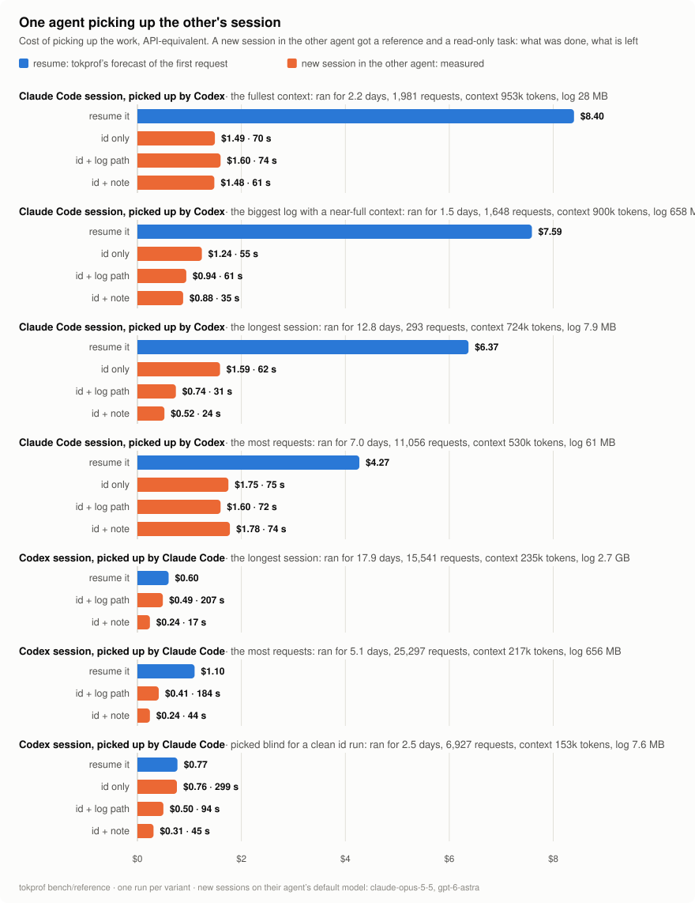

# One agent picking up the other's session

The [reference bench](reference-bench.md) measured how an agent picks up its own cold session from a reference instead of resuming it. This experiment swaps the agents. Codex picks up Claude Code sessions, and Claude Code picks up Codex sessions, from the same three kinds of reference. It ran on 2026-11-01 with Claude Code 2.1.311 and Codex 0.164.0 on one developer's machine, on the most extreme sessions of the logs.

<picture>
  <source media="(prefers-color-scheme: dark)" srcset="reference-cross-dark.svg">
  
</picture>

In short:
- **Each agent found and read the other's log from a reference alone.**
  - Codex knows where Claude Code keeps its transcripts.
  - Claude Code found Codex rollouts by searching `~/.codex` for the id in file names.
  - Both then pulled the prompts and messages out of the log with a short script.
- **The answers were as good as the same agent's.** 18 of 19 runs got all four facts right. The miss was a note that ended on "nothing is left" for a session that had open items, as in the same-agent runs.
- **Codex picked up the four big Claude Code sessions for $0.52–1.78.** Resuming them in Claude Code would have cost $4.27–8.40 for the first request alone. That holds although gpt-6-astra costs about 2.5× claude-opus-5-5 per token.
- **Claude Code picked up the Codex sessions for less than resuming them in Codex.** With the log path or a note it cost $0.24–0.50, against $0.60–1.10. With only the id, it had to search for the log first, and cost about as much as resuming: $0.76 against $0.77.
- **An id-only run must run alone.** Two of the first Claude Code id runs found the log path in the prompts of the path and note runs next to them.

## The earlier sessions

| Agent | Session | Picked as | Project | Ran for | Requests | Context at the end | Log | Resuming it, tokprof's forecast |
|---|---|---|---|---:|---:|---:|---:|---:|
| Claude Code | 32c500c2 | the fullest context | ~/src/billing | 2.2 days | 1,981 | 953k | 28.5 MB | $8.40 |
| Claude Code | 7bb3ca19 | the biggest log with a near-full context | ~/src/research | 1.5 days | 1,648 | 900k | 658 MB | $7.59 |
| Claude Code | 0f54de16 | the longest session | ~/src/monorepo | 12.8 days | 293 | 724k | 7.9 MB | $6.37 |
| Claude Code | bec2995a | the most requests | ~/src/billing | 7.0 days | 11,056 | 530k | 60.8 MB | $4.27 |
| Codex | 01a0eec6 | the longest session | ~/src/firmware | 17.9 days | 15,541 | 235k | 2.7 GB, by these runs a 1.5 GB `.zst` | $0.60 |
| Codex | 01a0b3f1 | the most requests | ~/src/compiler | 5.1 days | 25,297 | 217k | 656 MB `.zst` | $1.10 |
| Codex | 01a03fe1 | picked blind for a clean id run | ~/src/monorepo | 2.5 days | 6,927 | 153k | 7.6 MB `.zst` | $0.77 |

The six extreme sessions are the same as in the reference bench. Request counts include subagents.

The forecast for 0f54de16 had been $8.70. The session spans the Claude Code release that added request-audit lines. The X-ray read only the three audited requests after the break, the first of which re-wrote 721k tokens, and took that request for the session's pace. It now reads both parts of the conversation. The forecast is the X-ray's cost of the next request, which writes the whole context again, at the session's own model: claude-opus-5-5 for the Claude Code sessions and gpt-6.1-sol or gpt-5.6-sol for the Codex ones. Codex sessions stay under the 258k window however long they run, because Codex compacts them, so they are cheaper to resume.

## How it ran

[run.py](../bench/reference/run.py) with `--with codex` or `--with claude` started the new sessions in the other agent. They ran in the earlier session's project, on the agent's default model:
- **Claude Code** used claude-opus-5-5. It ran as `claude -p … --permission-mode dontAsk` with Read, Grep, Glob, Bash and subagents, without Edit or Write, and with a budget of $5.
- **Codex** used gpt-6-astra at the maximum effort. It ran as `codex exec --sandbox read-only`.

Every new session got the read-only task of the reference bench: find out what we did in the earlier session, what is done and what is left, answer in at most 15 lines, change nothing. In front of the task it got one of three references:
- `id`: `Continue from the earlier session <id>.`
- `path`: the line `tokprof handoff` prints, `Continue from the earlier session <id>. Its log: <path>.`
- `note`: what `tokprof handoff --note` prints, the line and a note built from the log without a model.

tokprof measured every new session from its own log. The answers were checked against four facts of each earlier session: the task, the main work, the last step, and what was left.

## Results

### Codex picking up Claude Code sessions

| Earlier session | Reference | Time | Requests | Tool calls | Final context | Cost | Facts right |
|---|---|---:|---:|---:|---:|---:|---:|
| 32c500c2, resume $8.40 | id | 70 s | 8 | 7 | 80.8k | $1.49 | 4 of 4 |
| | path | 74 s | 10 | 9 | 83.4k | $1.60 | 4 of 4 |
| | note | 61 s | 10 | 9 | 73.5k | $1.48 | 4 of 4 |
| 7bb3ca19, resume $7.59 | id | 55 s | 8 | 7 | 68.6k | $1.24 | 4 of 4 |
| | path | 61 s | 7 | 6 | 51.3k | $0.94 | 4 of 4 |
| | note | 35 s | 7 | 6 | 47.0k | $0.88 | 4 of 4 |
| 0f54de16, resume $6.37 | id | 62 s | 13 | 12 | 77.7k | $1.59 | 4 of 4 |
| | path | 31 s | 5 | 4 | 43.0k | $0.74 | 4 of 4 |
| | note | 24 s | 4 | 3 | 31.5k | $0.52 | 4 of 4 |
| bec2995a, resume $4.27 | id | 75 s | 9 | 8 | 93.4k | $1.75 | 4 of 4 |
| | path | 72 s | 9 | 8 | 83.9k | $1.60 | 4 of 4 |
| | note | 74 s | 9 | 8 | 93.4k | $1.78 | 4 of 4 |

### Claude Code picking up Codex sessions

| Earlier session | Reference | Time | Requests | Tool calls | Final context | Cost | Facts right |
|---|---|---:|---:|---:|---:|---:|---:|
| 01a0eec6, resume $0.60 | path | 207 s | 7 | 6 | 49.7k | $0.49 | 4 of 4 |
| | note | 17 s | 2 | 1 | 27.1k | $0.24 | 4 of 4 |
| 01a0b3f1, resume $1.10 | path | 184 s | 8 | 7 | 37.1k | $0.41 | 4 of 4 |
| | note | 44 s | 3 | 2 | 25.4k | $0.24 | 3 of 4 |
| 01a03fe1, resume $0.77 | id | 299 s | 14 | 13 | 65.1k | $0.76 | 4 of 4 |
| | path | 94 s | 9 | 8 | 57.9k | $0.50 | 4 of 4 |
| | note | 45 s | 3 | 2 | 46.6k | $0.31 | 4 of 4 |

Notes on the tables:
- The costs are tokprof's, from each new session's own log, API-equivalent.
- The 01a0b3f1 note ended on the demo being done and pushed. Claude Code with the note took that as "no open item left". The path run found in the log two checklist items left open the day before.
- The id runs for 01a0eec6 and 01a0b3f1 are left out; see below. 01a03fe1 stands in for them.

## How the agents worked

- **Codex reading Claude Code logs.** Given only the id, Codex first looked for a session or history tool and read the project's own notes. It then reached `~/.claude/projects/<project>/<id>.jsonl` in one of three ways:
  - for 32c500c2 and bec2995a, it went straight there;
  - for 7bb3ca19, it searched `~/.codex` and then `~/.claude` for the id in file names;
  - for 0f54de16, it searched its own sessions, then an IDE plugin's code for where sessions are kept, and then tried the likely places.

  It parsed the transcript with Python, bun or Node.
- **Claude Code reading Codex logs.** Given only the id, Claude Code first looked in its own `~/.claude/projects`. It then searched `~/.claude` and `~/.codex` for the id in file names, found the rollout and read the compressed log with `zstd -dc | jq`. That search is why the id run took five minutes.
- **Both checked the project's current state too.** They read git, the case files and the journals. So their answers often went past the earlier session, for example:
  - for 7bb3ca19, a decision the user had made since;
  - for 0f54de16, the merged pull request and the follow-up issue left open;
  - for 01a03fe1, that the work had reached `origin/master` under new commit hashes after a history rewrite.

## Keeping the id runs clean

The first Claude Code id runs, for 01a0eec6 and 01a0b3f1, ran at the same time as the path and note runs, in the same project. Their search for the id found those runs' transcripts, which named the log in their prompts, and one even held the note. Both are marked `contaminated` in the results and left out of the tables and the chart.

Since then [run.py](../bench/reference/run.py) works like this:
- It runs the id variants first and alone, before any prompt names the log.
- It writes each prompt to disk only when its run starts.
- It checks each id run's tool results for the words of the path and note prompts, and marks the run `contaminated` if they turn up.

All id runs in the tables passed that check.

The clean id run for Claude Code used 01a03fe1. It is a long Codex session that no earlier prompt had named, picked by a script that did not show its id. During that run, the id did turn up in the transcript of the session that ran the experiment, and the run's search came across it. That transcript held no path, and the run found the rollout by its file name.

## Logs move

Between two runs, Codex compressed the 01a0eec6 rollout on its own: the 2.7 GB `.jsonl` became a 1.5 GB `.jsonl.zst`. A path printed before that points to nothing. The agents find the log by its id anyway, and `tokprof handoff` prints the path the log has now.

## Limits

- **Single runs.** Each variant ran once. The gaps to resuming are clear, but the differences between the variants are within what a rerun could change.
- **Read-only task.** A session that goes on working pays for its own new context on top of the pickup.
- **Different prices.** The agents' models cost differently. Codex's pickups of Claude Code sessions ran on gpt-6-astra, Claude Code's of Codex sessions on claude-opus-5-5.
- **Same-agent estimate.** The X-ray's pickup estimate assumes the new session runs in the same agent as the old one.

## Running it again

```sh
python3 -I bench/reference/run.py ~/tokprof/reference-bench/$(date +%F)-cross-codex --with codex <claude code log>...
python3 -I bench/reference/run.py ~/tokprof/reference-bench/$(date +%F)-cross-claude --with claude <codex log>...
python3 -I bench/reference/chart.py docs/reference-cross.svg bench/reference/results/2026-11-01-cross*.json \
  --sessions claude-32c500c2:codex,claude-7bb3ca19:codex,claude-0f54de16:codex,claude-bec2995a:codex,codex-01a0eec6:claude,codex-01a0b3f1:claude,codex-01a03fe1:claude \
  --title "One agent picking up the other's session"
```

The runs are real sessions. They cost money, or subscription usage, and they show up in the agents' session lists. The numbers of these runs are in `bench/reference/results/2026-11-01-cross.json`, `-cross-extreme.json` and `-cross-blind.json`.
